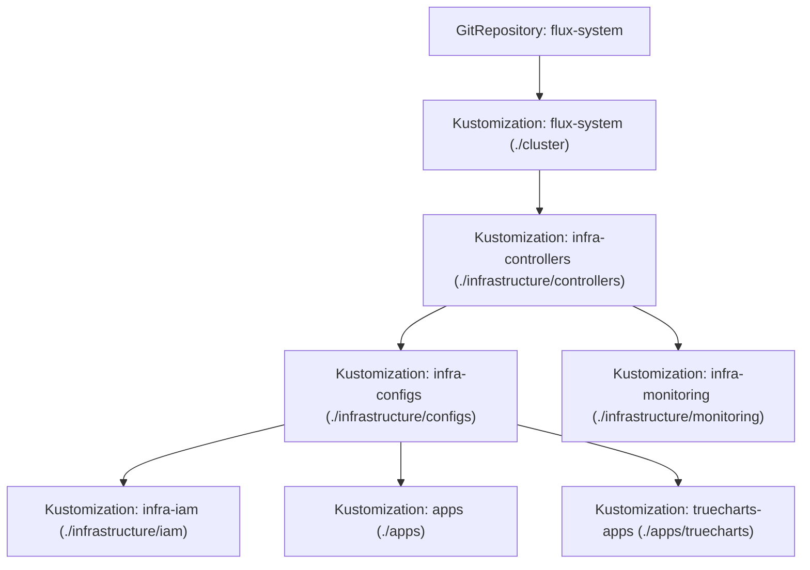

# GitOps Kubernetes Cluster

Declarative infrastructure and application deployment managed with [Flux v2](https://fluxcd.io/) GitOps on Kubernetes.

---

## Overview

This repository maintains the entire configuration, infrastructure components, secrets management, and application workloads for a self-hosted Kubernetes home cluster. Everything is defined as code using Kubernetes manifests, Kustomize overlays, and Helm releases, continuously reconciled by Flux.

### Core Technologies

- **GitOps Engine:** [Flux v2](https://fluxcd.io/) (Kustomize and Helm controllers, notification controller, webhook receivers)
- **Ingress Controller:** [Traefik](https://traefik.io/) (DaemonSet, TLS termination, forward authentication middleware, custom IngressRoutes)
- **Load Balancer & Networking:** [MetalLB](https://metallb.universe.tf/) (Layer 2 address pool management) and [Multus CNI](https://github.com/k8snetworkplumbingwg/multus-cni)
- **Persistent Storage:** [Longhorn](https://longhorn.io/) (distributed block storage with automated snapshots, fs-trim, and backups)
- **Certificate Management:** [cert-manager](https://cert-manager.io/) (ACME DNS-01 challenge via Cloudflare for `*.teamg.app`)
- **Database Operator:** [CloudNativePG (CNPG)](https://cloudnative-pg.io/) for high-availability PostgreSQL
- **Hardware Acceleration:** [Intel GPU Device Plugin](https://github.com/intel/intel-device-plugins-for-kubernetes) with [Node Feature Discovery (NFD)](https://kubernetes-sigs.github.io/node-feature-discovery/)
- **Identity & Access Management:** [Pocket ID](https://pocket-id.org/) (OIDC provider) and [Cloudflare Tunnel](https://developers.cloudflare.com/cloudflare-one/connections/connect-networks/)
- **Observability:** [kube-prometheus-stack](https://github.com/prometheus-community/helm-charts/tree/main/charts/kube-prometheus-stack) (Prometheus, Grafana, Alertmanager) with Discord notifications
- **Secret Encryption:** [Mozilla SOPS](https://github.com/getsops/sops) with [Age](https://github.com/FiloSottile/age)
- **Automated Dependency Updates:** [Renovate](https://docs.renovatebot.com/) running scheduled in-cluster cron jobs

---

## GitOps Architecture & Reconciliation Flow

Flux syncs the cluster state directly from Git using a layered dependency hierarchy:



### Dependency Order

1. **`flux-system`** ([`cluster/flux-system/gotk-sync.yaml`](cluster/flux-system/gotk-sync.yaml)): Bootstraps the cluster entrypoint from the `./cluster` directory.
2. **`infra-controllers`** ([`cluster/infrastructure.yml`](cluster/infrastructure.yml)): Deploys foundational operators and CRDs (Cert-Manager, CloudNativePG, Intel GPU, Longhorn, MetalLB, Multus, NFD, Traefik, VPA, Renovate).
3. **`infra-configs`** ([`cluster/infrastructure.yml`](cluster/infrastructure.yml)): Configures controller resources (MetalLB IP pools, Cert-Manager cluster issuers and wildcards, Longhorn storage classes and backup jobs, Traefik entrypoints and IngressRoutes, Flux webhook receiver).
4. **`infra-monitoring`** ([`cluster/infrastructure.yml`](cluster/infrastructure.yml)): Prometheus operator, Grafana, Alertmanager, and Flux alert providers routing notifications to Discord.
5. **`infra-iam`** ([`cluster/infrastructure.yml`](cluster/infrastructure.yml)): Pocket ID identity provider and Cloudflare tunnel endpoints.
6. **`apps`** & **`truecharts-apps`** ([`cluster/apps.yml`](cluster/apps.yml)): User-facing services and workload Helm releases.

---

## Repository Structure

```
├── .sops.yaml                       # SOPS encryption rules and Age public key mappings
├── renovate.json                    # Automated dependency update configuration
├── kustomizeconfig.yml              # Kustomize nameReference definitions for HelmReleases
├── cluster/                         # Flux root Kustomization definitions
│   ├── apps.yml                     # App layer Flux Kustomizations
│   ├── infrastructure.yml           # Infrastructure layer Flux Kustomizations
│   └── flux-system/                 # Flux toolkit components and sync manifests
│       ├── gotk-components.yaml
│       └── gotk-sync.yaml
├── infrastructure/                  # Core cluster platform services
│   ├── controllers/                 # Helm releases and manifests for platform operators
│   │   ├── cert-manager/            # Certificate automation controller
│   │   ├── cnpg/                    # CloudNative-PG database operator
│   │   ├── intel-gpu-plugin/        # Intel GPU device plugin DaemonSet & feature rules
│   │   ├── longhorn/                # Distributed storage controller & S3 backup secret
│   │   ├── metallb/                 # Bare-metal load balancer controller
│   │   ├── multus/                  # Multiple network interfaces CNI
│   │   ├── node-feature-discovery/  # Hardware discovery operator
│   │   ├── renovate/                # In-cluster Renovate scheduled bot
│   │   ├── traefik/                 # Ingress controller DaemonSet & service bindings
│   │   └── vpa/                     # Vertical Pod Autoscaler
│   ├── configs/                     # Custom configurations, CRDs, and cluster issuers
│   │   ├── cert-manager/            # Let's Encrypt DNS-01 ClusterIssuers & tokens
│   │   ├── longhorn/                # Backup schedules, fs-trim, and CNPG storage class
│   │   ├── metallb.yml              # IP address pools and L2 advertisement
│   │   ├── flux-webhook.yml         # Webhook receiver for immediate Git triggers
│   │   └── traefik/                 # IngressRoutes, TLS stores, auth middlewares, external services
│   ├── iam/                         # Identity and access control
│   │   ├── cloudflared/             # Cloudflare Tunnel deployment and credentials
│   │   └── pocket-id/               # Pocket ID OIDC service deployment and storage
│   └── monitoring/                  # Observability and alerting
│       ├── flux/                    # Flux alerting provider and Discord webhooks
│       └── kube-prometheus-stack/   # Prometheus, Grafana dashboards, Alertmanager configs
└── apps/                            # Application workloads
    ├── ai/                          # Artificial intelligence stack
    │   ├── open-webui/              # Open-WebUI web client with Pocket ID OIDC
    │   ├── qdrant/                  # Vector search engine
    │   └── searxng/                 # Privacy-respecting metasearch engine
    ├── mealie/                      # Recipe and meal planning manager
    ├── razzia/                      # Quiz and game web application
    ├── truecharts/                  # Applications using TrueCharts common library charts
    │   ├── actualserver/            # Actual Budget personal finance server
    │   ├── adguard-home/            # Network-wide DNS ad-blocking
    │   ├── audiobookshelf/          # Audiobook and podcast streaming server
    │   ├── cloudflareddns/          # Dynamic DNS updater for Cloudflare
    │   ├── home-assistant/          # Home automation platform (with Multus network)
    │   ├── homepage/                # Customizable dashboard
    │   ├── immich/                  # High-performance photo and video backup
    │   ├── profilarr/               # Configuration management for Arr stack
    │   ├── prowlarr/                # Indexer manager for Sonarr and Radarr
    │   ├── qbittorrent/             # Torrent downloader
    │   ├── radarr/                  # Movie collection manager
    │   ├── seerr/                   # Media discovery and request manager
    │   ├── sonarr/                  # TV series collection manager
    │   ├── uptime-kuma/             # Status monitoring tool
    │   └── vaultwarden/             # Bitwarden-compatible password manager
    ├── truenas-auto-update/         # Scheduled automation jobs for TrueNAS systems
    └── unifi-os-server/             # UniFi network controller deployment
```

---

## Infrastructure & Networking

### Ingress & Traffic Management

- **Traefik Ingress Controller**: Deployed as a `DaemonSet` on port `80` (HTTP, with automatic redirect to HTTPS) and `443` (HTTPS with HTTP/3 support).
- **MetalLB**: Provides bare-metal VIPs:
  - Traefik main web traffic: `10.25.25.11`
  - Additional load balancer ports for SSH bastion endpoints:
    - TSP SSH: `10.25.25.12:22` (`port 50022`)
    - PiKVM SSH: `10.25.25.13:22` (`port 50122`)
- **Cloudflare Tunnel (`cloudflared`)**: Exposes select internal services securely to external networks without opening router inbound ports.

### TLS Certificates & DNS

- **cert-manager**: Manages automated certificate renewal with Let's Encrypt.
- **ACME DNS-01 Challenge**: Authenticates domains using Cloudflare API tokens encrypted with SOPS.
- **Default TLS Store**: Traefik utilizes a generated wildcard certificate (`*.teamg.app`) for internal and external routes.

### Persistent Storage

- **Longhorn**: Primary distributed block storage provider.
  - Dedicated storage class [`infrastructure/configs/longhorn/sc-cnpg.yml`](infrastructure/configs/longhorn/sc-cnpg.yml) optimized for transactional database workloads (CloudNativePG).
  - Automated recurring jobs for snapshots, weekly filesystem trimming ([`fs-trim`](infrastructure/configs/longhorn/fs-trim.yml)), and encrypted backups to remote S3 storage ([`backup`](infrastructure/configs/longhorn/backup.yml)).

### Hardware Acceleration

- **Node Feature Discovery (NFD)**: Detects hardware capabilities across nodes.
- **Intel Device Plugins**: Grants GPU devices (`intel.feature.node.kubernetes.io/gpu`) to pods requiring hardware transcoding (e.g., video processing in media workloads).

---

## Secrets Management

Secrets in this repository are securely encrypted at rest using [Mozilla SOPS](https://github.com/getsops/sops) with [Age](https://github.com/FiloSottile/age). Only encrypted files (`*.enc.yml`, `*.enc.env`, etc.) are committed to Git.

### Encryption Configuration

The encryption rules are configured in [`.sops.yaml`](.sops.yaml):

- **Age Recipient Key:** `age14g7x5d8jach0wpvjvc29dceu26zgr88wflnjg0qj43r0gf977ffq55dhya`
- In-cluster Flux Kustomizations decrypt secrets dynamically using the `sops-age` secret residing in the `flux-system` namespace.

### Working with Secrets

#### 1. Setup Environment

Ensure the Age private key is exported locally:

```bash
export SOPS_AGE_KEY_FILE=~/.config/sops/age/keys.txt
```

#### 2. Encrypt a New Secret File

To encrypt a file in place using the matching rule from [`.sops.yaml`](.sops.yaml):

```bash
sops --encrypt --in-place path/to/secret.enc.yml
```

#### 3. Edit an Existing Encrypted File

To open and edit an encrypted secret with your default `$EDITOR`:

```bash
sops path/to/secret.enc.yml
```

#### 4. Decrypt and View File

To inspect decrypted content in standard output:

```bash
sops --decrypt path/to/secret.enc.yml
```

---

## Operational Commands & Common Workflows

### Reconciling Changes Immediately

By default, Flux checks for Git repository updates on a 1-hour interval. To trigger immediate reconciliation with the [`flux`](cluster/flux-system/gotk-sync.yaml:1) CLI:

```bash
# Reconcile Git repository source
flux reconcile source git flux-system

# Reconcile infrastructure controllers
flux reconcile kustomization infra-controllers --with-source

# Reconcile infrastructure configurations
flux reconcile kustomization infra-configs --with-source

# Reconcile application workloads
flux reconcile kustomization apps --with-source
flux reconcile kustomization truecharts-apps --with-source
```

### Checking GitOps Status

```bash
# View status of all Flux Kustomizations
flux get kustomizations

# View status of all Helm releases
flux get helmreleases -A

# Check for Helm release drift or errors
kubectl get helmreleases -A -o wide
```

### Git Webhook Trigger

An internal webhook receiver is deployed at [`infrastructure/configs/flux-webhook.yml`](infrastructure/configs/flux-webhook.yml) to automatically notify Flux of new commits on push, triggering an instantaneous sync without waiting for the scheduled poll interval.

---

## Adding a New Application

1. **Create the application directory:**
   - For standard Kubernetes/Helm workloads: place manifests under [`apps/<app-name>/`](apps).
   - For TrueCharts library charts: place manifests under [`apps/truecharts/<app-name>/`](apps/truecharts).
2. **Define necessary manifests:**
   - `helmrelease.yml` (specifying chart repository and release parameters)
   - `ingress-route.yml` (Traefik IngressRoute defining the host match and services)
   - `namespace.yml` (if deploying into a dedicated namespace)
   - `kustomization.yml` (listing all resources, secrets, and configurations)
3. **Register in the parent overlay:**
   - Add the folder to [`apps/kustomization.yml`](apps/kustomization.yml) or [`apps/truecharts/kustomization.yml`](apps/truecharts/kustomization.yml).
4. **Encrypt sensitive configuration:**
   - Add encrypted values or tokens to `.enc.yml` or `.enc.env` adhering to [`.sops.yaml`](.sops.yaml).
5. **Commit and push:**
   - Flux will detect the new definitions and apply them automatically.
