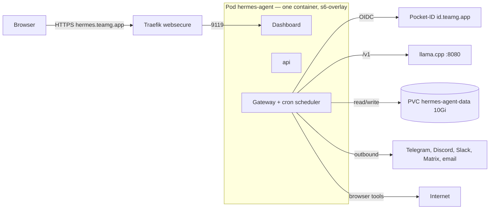

# Hermes Agent

[Nous Research Hermes Agent](https://github.com/NousResearch/hermes-agent) runs as
a single `Deployment` in the shared `ai` namespace. The dashboard is served at
<https://hermes.teamg.app>; the OpenAI-compatible API stays cluster-internal. It
is a self-improving agent: it takes instructions from messaging platforms and its
dashboard, and it runs shell commands and browser automation as tools.

| Item       | Value                                                                         |
| ---------- | ----------------------------------------------------------------------------- |
| Manifests  | [`fluxcd/apps/ai/hermes-agent/`](.)                                           |
| Workload   | `Deployment/hermes-agent`, 1 replica, `Recreate`, `kubernetes.io/arch: amd64` |
| Image      | `nousresearch/hermes-agent:v0.23.2` (Renovate-tracked, tag only)              |
| Service    | `ai/hermes-agent`, ClusterIP `8642` (api) and `9119` (dashboard)              |
| Edge       | `hermes-agent` IngressRoute, Traefik `websecure`, host `hermes.teamg.app`     |
| Config     | ConfigMap `ai/hermes-agent-config` (`config.yaml`, mounted via `subPath`)     |
| Secrets    | Secret `ai/hermes-agent-secret` (`API_SERVER_KEY`, OIDC client, SOPS)         |
| Storage    | PVC `ai/hermes-agent-data`, 10Gi `longhorn`, ReadWriteOnce                    |
| Model      | Not pinned — chosen in the dashboard or `/opt/data/config.yaml`               |
| Auth       | Pocket-ID OIDC at `https://id.teamg.app`                                      |
| Scheduling | `kubernetes.io/arch: amd64`; currently on `beast`                             |

## Blocking manual steps

Two of these were required before the deployment was usable and are now done.
They are recorded here so a rebuild can repeat them; Git alone cannot perform
any of the three.

1. **Register the Pocket-ID client** — _done 2026-11-18_. In the Pocket-ID UI at
   <https://id.teamg.app>, create a **public (PKCE) client** for the dashboard
   with redirect URI `https://hermes.teamg.app/*` (or the exact callback Hermes
   documents). No client secret is issued or needed: a public client
   authenticates with PKCE, so only the client ID is stored in
   [`secrets/enc.env`](secrets/enc.env). To
   change it:

   ```bash
   # Decrypts to a temp file, re-encrypts on save.
   sops fluxcd/apps/ai/hermes-agent/secrets/enc.env

   # Or, when replacing the file from a plaintext copy:
   sops --encrypt --in-place fluxcd/apps/ai/hermes-agent/secrets/enc.env
   ```

   Commit and reconcile. `HERMES_DASHBOARD_OIDC_CLIENT_ID` holds the real client
   ID. If it is missing or stale, the dashboard fails closed at startup rather
   than falling back to an unauthenticated mode.

2. **Confirm the model credentials.** The managed config no longer pins a model
   or provider, so the model comes from `/opt/data/config.yaml` on the PVC (the
   dashboard writes there). If it points at OpenRouter, the pod needs
   `OPENROUTER_API_KEY` in `/opt/data/.env`. The local llama.cpp Service
   (`llama-cpp:8080`) and its `gemma4-12b-mtp` preset need no key.

3. **Accept the terminal warning.** Hermes logs that `terminal.backend: local`
   is unsandboxed while the API binds `0.0.0.0`. This is accepted: the API is
   not published, and the only consumer is in-cluster.

## What it is, and what it is not

Hermes is **one container**, not a microservice stack. The image is supervised by
s6-overlay, and the gateway, the OpenAI-compatible API, the dashboard and the
cron scheduler are processes inside that container. There is no Postgres and no
Redis: state is a SQLite database plus files on one volume.

Because the agent executes shell commands and drives a browser, treat it as a
workload with the same trust level as a shell on the node it runs on. The
controls that matter are the ones around it: the OIDC gate on the dashboard, the
fact that the API is not published, and the fact that it runs on a worker rather
than the control plane.

## Architecture



The dashboard and the API are the same process tree; the Service exposes both
ports. Only `9119` is routed from outside the cluster.

## Files

| File                                                                    | Purpose                                                                     |
| ----------------------------------------------------------------------- | --------------------------------------------------------------------------- |
| [`kustomization.yml`](kustomization.yml)                                | Namespace, resource list, `configMapGenerator`, `secretGenerator`           |
| [`deploy.yml`](deploy.yml)                                              | Deployment: image, args, env, security context, probes, resources, mounts   |
| [`config.yml`](config.yml)                                              | Source for the managed `config.yaml` (terminal, dashboard, database)        |
| [`svc.yml`](svc.yml)                                                    | ClusterIP Service, ports `8642` and `9119`                                  |
| [`pvc.yml`](pvc.yml)                                                    | 10Gi Longhorn ReadWriteOnce claim for `/opt/data`                           |
| [`ingress-route.yml`](ingress-route.yml)                                | Traefik route `hermes.teamg.app` -> `9119`                                  |
| [`secrets/enc.env`](secrets/enc.env)                                    | SOPS-encrypted API bearer key, OIDC client ID and MCP client tokens         |

## Decisions and why

| Decision                                  | Rejected alternative                    | Why                                                                                                                                                                                                                                           |
| ----------------------------------------- | --------------------------------------- | --------------------------------------------------------------------------------------------------------------------------------------------------------------------------------------------------------------------------------------------- |
| `nodeSelector: kubernetes.io/arch: amd64` | Schedule anywhere, or pin a hostname    | The image is published for amd64 only. `rpi5` is arm64 _and_ tainted `dedicated=rpi5:NoSchedule`, so it is excluded twice over. Add `kubernetes.io/hostname` only if `hedy`/`beast` contention appears; `Recreate` + RWO makes the move safe. |
| Tag only, no digest                       | Pin `image@sha256:...`                  | `renovate.json` has no `pinDigests`, so a digest pin would silently freeze the app. Upstream publishes moving `vX.Y.Z` tags.                                                                                                                  |
| Root container with five capabilities     | `runAsNonRoot: true`                    | The s6 entrypoint must chown `/opt/data` to `HERMES_UID:HERMES_GID` (10000) and then drop to that user. It cannot chown as non-root.                                                                                                          |
| No `fsGroup`                              | `fsGroup: 10000`                        | The image owns the chown. `fsGroup` would make the kubelet recursively rewrite ownership of a growing volume on every mount.                                                                                                                  |
| `strategy: Recreate`                      | `RollingUpdate`                         | The RWO volume cannot be attached by two pods; a rolling update would deadlock on a multi-attach.                                                                                                                                             |
| Longhorn RWO volume                       | NFS/SMB, or `hostPath`                  | SQLite in WAL mode needs real POSIX locking and `fsync`. Longhorn provides a block-backed filesystem and automatic backups.                                                                                                                   |
| Pocket-ID OIDC                            | Basic auth                              | Hermes fails closed when bound non-loopback without an auth provider. Basic auth is one shared string with no MFA on a publicly resolvable hostname.                                                                                          |
| API `8642` cluster-internal only          | Publish it on Traefik                   | Only in-cluster clients need it. Keeping it unpublished keeps the unsandboxed `local` terminal backend off the internet.                                                                                                                      |
| Managed ConfigMap mounted via `subPath`   | Mount the whole `/etc/hermes` directory | A directory mount would shadow the image's `chromium-executable-path` and `image-provenance.json`, breaking browser tools.                                                                                                                    |
| HTTP `/health` probes on `8642`           | `tcpSocket` probes                      | s6 keeps PID 1 alive when the gateway dies, so a TCP probe would report `Ready` on a dead agent.                                                                                                                                              |
| Single replica                            | Two or more replicas                    | One SQLite data directory on one RWO volume. A second replica would corrupt the database, not add availability.                                                                                                                               |
| Writable root filesystem                  | `readOnlyRootFilesystem: true`          | s6 writes its supervision tree and service state under `/run` and `/var/run`. A read-only root would need a long list of `emptyDir`s and still risk the s6 hand-off.                                                                          |

## Configuration layering

Hermes reads two config files:

- `/opt/data/config.yaml` — user config on the PVC, editable from inside the pod.
- `/etc/hermes/config.yaml` — managed config from the ConfigMap, read because
  `HERMES_MANAGED_DIR=/etc/hermes`.

**Managed scope wins per leaf key.** The managed file pins terminal, dashboard,
database, STT and MCP settings, so editing those in `/opt/data/config.yaml` from
inside the pod has no effect. It deliberately does not pin `model.*`: the main
model, provider and credentials are chosen on the PVC or in the dashboard and
may drift from Git.

The mount is a **single file**, not a directory:

```yaml
- name: config
  mountPath: /etc/hermes/config.yaml
  subPath: config.yaml
  readOnly: true
```

This is a real trap. `/etc/hermes` also holds the image's
`chromium-executable-path` and `image-provenance.json`. Mounting the ConfigMap
over the whole directory would hide both, and browser tools would fail in a way
that looks unrelated to configuration.

The generator key must be literally `config.yaml`, because that is the filename
Hermes looks for under `HERMES_MANAGED_DIR`. The source file keeps the repo's
`.yml` extension and is remapped on the way in:

```yaml
configMapGenerator:
  - name: hermes-agent-config
    files:
      - config.yaml=config.yml
```

Everything else the agent persists lives on the PVC and is not in Git: `.env`,
`auth.json`, `SOUL.md`, `state.db`, `sessions/`, `memories/`, `skills/`,
`cron/`, `hooks/`, `logs/` and `home/`.

## Model backend

The managed config deliberately pins no `model.*` keys. Hermes resolves the
main model and provider from `/opt/data/config.yaml` on the PVC (the dashboard
writes there), or from a per-invocation CLI override. Two routes are available:

- **Hosted via OpenRouter.** Set `model.provider: openrouter` and a model such
  as `deepseek/deepseek-v4.1-flash-1017`, with no `base_url` or `api_key`: the
  provider resolves `https://openrouter.ai/api/v1` and reads
  `OPENROUTER_API_KEY` from `/opt/data/.env`. The key never enters Git.
- **Local llama.cpp.** Set `model.provider: custom`,
  `model.base_url: http://llama-cpp.ai.svc.cluster.local:8080/v1` and
  `model.api_key: sk-no-key-required` (llama.cpp ignores the `Authorization`
  header); `gemma4-12b-mtp` is a `load-on-startup = 1` preset in
  [`models-preset.ini`](../llama.cpp/models-preset.ini). llama.cpp
  runs `--models-max 2`, so Gemma and the `bge-m3` embedder stay resident.
  Asking for a third model would swap an 11-13 GB GGUF and can take a minute or
  more.

Because neither key is managed, changing the model in the dashboard is allowed
and Git no longer guarantees the endpoint. A PVC config with no `model:`
mapping falls back to Hermes' built-in default, which may lack credentials.

`model.context_length` is an override, not a required field
(`get_model_context_length`, step 0 in `agent/model_metadata.py`); leave it
absent so the window follows the provider catalog, or pin it when nothing
advertises the real limit — e.g. a llama.cpp preset, where it is
`ctx-size / parallel`. Hermes fires compression at 0.5 x the window.

`terminal.backend: local` because the docker backend cannot work on containerd
(there is no Docker socket). The agent runs commands directly in its own
container.

## MCP servers

`mcp_servers` in the managed config points at the in-cluster MCP workloads under
[`fluxcd/apps/ai/mcp/`](../mcp/). The Traefik hosts are not used:
the gateway already runs inside the cluster, so the extra DNS and TLS hop would
only add a way to break a toolset.

| Server       | Endpoint                                              | Auth                                        |
| ------------ | ----------------------------------------------------- | ------------------------------------------- |
| `gitea`      | `http://gitea-mcp.ai.svc.cluster.local:8080/mcp`      | server holds the Gitea PAT, no header       |
| `kubernetes` | `http://kubernetes-mcp.ai.svc.cluster.local:8080/mcp` | pod ServiceAccount, **cluster-admin**       |
| `mealie`     | `http://mealie-mcp.ai.svc.cluster.local:8000/mcp`     | server holds the Mealie token, no header    |
| `linkedin`   | `http://linkedin-mcp.ai.svc.cluster.local:8080/mcp`   | `Bearer ${LINKEDIN_MCP_TOKEN}`              |
| `actual`     | `http://actual-mcp.ai.svc.cluster.local:3600/http`    | `Bearer ${ACTUAL_MCP_TOKEN}`, read-only     |
| `wger`       | `http://wger-mcp.ai.svc.cluster.local:8765/mcp`       | `Bearer ${WGER_MCP_TOKEN}`                  |
| `paperless`  | `http://paperless-mcp.ai.svc.cluster.local:3001/mcp`  | `Bearer ${PAPERLESS_MCP_TOKEN}`             |
| `tandoor`    | `http://tandoor-mcp.ai.svc.cluster.local:3737/mcp`    | `Bearer ${TANDOOR_MCP_TOKEN}`               |

The `kubernetes` entry is a full cluster-admin credential by design
([`rbac.yml`](../mcp/kubernetes-mcp/rbac.yml) says why): it is how
the agent applies a fix directly when Git is the slow path, and it is also how
the SOPS age key is retrievable for a `sops` edit. Treat any agent session with
that MCP enabled as root on the cluster.

Two path conventions exist and they are not interchangeable: the FastMCP servers
answer on `/mcp`, `actual-mcp-server` on `/http` (with `/health` on the same port
for its probes). A server wired to the wrong path registers with no usable
tools.

`microsoft-learn` (hosted SaaS) and `playwright` (stdio binary inside the pod)
are not workloads of this repository and stay in `/opt/data/config.yaml` on the
PVC.

### Adding a token for a new MCP server

Worked example: `actual`.

1. The consuming server's own Secret holds the token
   (`MCP_SSE_AUTHORIZATION` in
   [`actual-mcp/secrets/enc.env`](../mcp/actual-mcp/secrets/enc.env)).
2. This app's [`secrets/enc.env`](secrets/enc.env)
   holds the same value sealed as `ACTUAL_MCP_TOKEN`.
3. [`deploy.yml`](deploy.yml) maps that key to
   the `ACTUAL_MCP_TOKEN` env var.
4. [`config.yml`](config.yml) references
   `Bearer ${ACTUAL_MCP_TOKEN}`. The managed overlay expands `${...}` from the
   **process** environment only, so a missing env entry leaves the literal
   `${ACTUAL_MCP_TOKEN}` and the server answers 401.

Two traps. A key added to `secrets/enc.env` without a matching
`.sops.yaml` `encrypted_regex` entry is written and committed in plaintext. And
two sops env files cannot share one `secretGenerator`: both carry the same
`sops_*` metadata keys and kustomize rejects the repeated key, so every token
belongs in this one file rather than in a new file per server.

The age key needed for `sops -d` and `sops -e -i` is in the
`flux-system/sops-age` Secret (`age.agekey`): read it, write it to a mode-600
file, and point `SOPS_AGE_KEY_FILE` at it. Every value is re-encrypted on save,
so the diff shows all lines changed even when a single key was added.

## Storage

```yaml
spec:
  storageClassName: longhorn
  accessModes:
    - ReadWriteOnce
  resources:
    requests:
      storage: 10Gi
```

The claim carries `kustomize.toolkit.fluxcd.io/ssa: IfNotPresent`, so pruning or
re-applying the Kustomization never recreates it. Longhorn creates volumes with
reclaim policy `Retain` (`persistence.reclaimPolicy` in the Longhorn
HelmRelease), so the data also survives deleting the claim.

SQLite runs in WAL mode (`database.journal_mode: wal`). WAL needs real POSIX
locking and `fsync`; Longhorn's block-backed filesystem provides both. Never move
this volume to NFS or SMB.

Backups are automatic. The Longhorn HelmRelease attaches the `default`
recurring-job group to every volume, and the `backup` RecurringJob runs every
4 hours with 42 retained copies to the Garage S3 target. There is no per-app
annotation to add.

## Exposure

The dashboard is routed at the root of its own host:

```yaml
- match: Host(`hermes.teamg.app`) && PathPrefix(`/`)
  kind: Rule
  services:
    - name: hermes-agent
      port: 9119
```

There is no `tls:` block: TLS comes from the default TLSStore certificate
`teamg-app-tls`, the wildcard `*.teamg.app` certificate.

The API is **not** published. It is reachable only through the ClusterIP
Service:

```text
http://hermes-agent.ai.svc.cluster.local:8642/v1
```

No LLM front-end is deployed in this repository; an external client can use
that base URL directly with `API_SERVER_KEY` as the bearer token.

Subpath hosting (`https://teamg.app/hermes`) is **not supported**: the
dashboard's asset and API paths are absolute, so any `PathPrefix` other than `/`
breaks the UI.

The webapp on `9120` is not enabled. Upstream requires `webapp.enabled: true`,
it binds loopback, and it does not support subpath hosting either.

## Authentication

The dashboard uses Pocket-ID OIDC with issuer `https://id.teamg.app`. The client
ID and secret come from the SOPS secret.

This is not optional. Hermes fails closed when it is bound to a non-loopback
address without an auth provider, so the dashboard would refuse to serve without
one. Basic auth was rejected: it is one shared string, it has no MFA, and
`*.teamg.app` is publicly resolvable.

`dashboard.trusted_proxies` is set to the pod CIDR:

```yaml
dashboard:
  public_url: https://hermes.teamg.app
  trusted_proxies:
    - 10.244.0.0/16
```

Cilium runs with `ipam: kubernetes`, so the pod CIDR comes from the
kube-controller-manager `--cluster-cidr` and the node `podCIDRs`, not from a
Cilium pool setting. Without the correct CIDR the dashboard does not trust
Traefik's forwarded headers and builds `http://` callbacks.

## Security posture

The container must start as root. The image's s6 entrypoint remaps its internal
user to `HERMES_UID`/`HERMES_GID` (10000), chowns `/opt/data`, then drops
privileges with `s6-setuidgid`. `runAsNonRoot: true` is impossible.

```yaml
securityContext:
  runAsUser: 0
  runAsGroup: 0
  runAsNonRoot: false
  seccompProfile:
    type: RuntimeDefault
```

The container adds back only what the hand-off needs:

```yaml
allowPrivilegeEscalation: false
privileged: false
capabilities:
  drop:
    - ALL
  add:
    - CHOWN
    - DAC_OVERRIDE
    - FOWNER
    - SETGID
    - SETUID
```

There is no `fsGroup`, and the root filesystem is writable on purpose. The
namespace enforces Pod Security `baseline` with `restricted` audit and warn, so
this pod is admitted but flagged. That is the intended trade-off: the
alternative is a container that cannot start.

`automountServiceAccountToken: false` — the agent never talks to the Kubernetes
API.

## Runtime settings

| Variable                              | Value                  | Why                                            |
| ------------------------------------- | ---------------------- | ---------------------------------------------- |
| `HERMES_UID` / `HERMES_GID`           | `10000`                | uid/gid s6 drops to after chowning `/opt/data` |
| `TZ`                                  | `Pacific/Auckland`     | log and cron timestamps                        |
| `HERMES_MANAGED_DIR`                  | `/etc/hermes`          | where the managed `config.yaml` is read from   |
| `API_SERVER_ENABLED`                  | `true`                 | enables `/health` and the `/v1` API            |
| `API_SERVER_HOST` / `API_SERVER_PORT` | `0.0.0.0` / `8642`     | bind for in-cluster clients                    |
| `HERMES_DASHBOARD` / `..._PORT`       | `1` / `9119`           | dashboard process                              |
| `HERMES_DASHBOARD_OIDC_ISSUER`        | `https://id.teamg.app` | Pocket-ID                                      |
| `API_SERVER_KEY`                      | Secret                 | bearer token for `/v1`                         |
| `HERMES_DASHBOARD_OIDC_CLIENT_ID`     | Secret                 | OIDC client ID (public PKCE client)            |
| `ACTUAL_MCP_TOKEN`                    | Secret                 | bearer for the Actual MCP server               |
| `TANDOOR_MCP_TOKEN`                   | Secret                 | bearer for the Tandoor MCP server              |

All three probes hit `GET /health` on port `8642`:

| Probe     | Period | Failure threshold | Notes                             |
| --------- | ------ | ----------------- | --------------------------------- |
| startup   | 10s    | 60                | up to 10 minutes for a cold start |
| readiness | 10s    | 3                 |                                   |
| liveness  | 30s    | 3                 |                                   |

`/health` is served by the gateway process itself, and it only exists when
`API_SERVER_ENABLED=true`. That is why the API is enabled even though it is not
published: the probes depend on it.

Resources: requests `500m` / `2Gi`, limits `2` / `4Gi`. Upstream recommends
2-4 GiB, and browser tools need at least 2 GiB.

Other settings: `terminationGracePeriodSeconds: 60` so s6 can stop both
processes and flush the SQLite WAL; `revisionHistoryLimit: 3`;
`imagePullPolicy: IfNotPresent`; `args: [gateway, run]` appended to the image
entrypoint (never override the entrypoint — it performs the chown and the
privilege drop). `/dev/shm` is a 1Gi memory-backed `emptyDir` for Chromium, and
`/tmp` is a 256Mi `emptyDir`.

## Updates

Renovate tracks the image tag through the `kubernetes` manager, which already
scans `deploy.yml`. The package rule for `nousresearch/hermes-agent` disables
automerge and enforces a 7-day `minimumReleaseAge`, because this is a stateful
single-replica agent.

The image is pinned by tag only. `renovate.json` has no `pinDigests`, so adding a
digest would silently freeze the app. Never use `stable`, `latest` or `main`.

## Current status

Verified on 2026-11-18, revision `3cc1383b`:

- Flux `Kustomization apps` is `Ready=True`.
- Pod is `1/1 Running`, 0 restarts, on `beast` (amd64). `rpi5` is never
  selected.
- `GET /health` returns:

  ```json
  { "status": "ok", "platform": "hermes-agent", "version": "0.23.2" }
  ```

- A real completion through the gateway reached llama.cpp and returned
  content (`prompt_tokens: 10229`); at the time, the managed model config was
  in effect.
- `hermes config check` prints `Config version: 53 ✓`. The PVC copy of
  `config.yaml` had a stray `{}` at line 54 that made Hermes fall back to
  defaults; it was repaired in place, with a timestamped backup left on the
  volume.
- OIDC login returns `302` to `https://id.teamg.app/authorize` with
  `code_challenge_method=S256` and callback
  `https://hermes.teamg.app/auth/callback` — a public PKCE client, no secret.
- PVC `hermes-agent-data` is `Bound`, 10Gi, `ReadWriteOnce`, class `longhorn`.
- Service `hermes-agent` is ClusterIP with ports `8642` and `9119`.
- The pod CIDR is `10.244.0.0/16`, which is the `dashboard.trusted_proxies`
  value.

## Operations

### Verify

```bash
flux get kustomization apps
kubectl -n ai get deploy hermes-agent -o wide
kubectl -n ai get pod -l app=hermes-agent -o wide
kubectl -n ai get pvc hermes-agent-data
kubectl -n ai get svc hermes-agent
```

Check the agent itself, not just the listener. Run this from a pod in the
cluster, or port-forward the Service:

```bash
kubectl -n ai port-forward svc/hermes-agent 8642:8642
curl -s http://localhost:8642/health
```

### Upgrade

1. Read the upstream changelog for state migrations.
2. Optionally take a manual Longhorn snapshot. Scale to 0 first for a clean copy:

   ```bash
   kubectl -n ai scale deploy/hermes-agent --replicas=0
   # Create the snapshot of hermes-agent-data in the Longhorn UI.
   kubectl -n ai scale deploy/hermes-agent --replicas=1
   ```

   Flux re-applies `replicas: 1` on its next reconcile, so take the snapshot
   promptly.

3. Bump the tag in [`deploy.yml`](deploy.yml),
   commit, and reconcile:

   ```bash
   flux reconcile kustomization apps --with-source
   kubectl -n ai rollout status deploy/hermes-agent
   ```

Expect a short outage. `Recreate` plus a single replica is inherent to the
single-data-dir design.

### Rollback

Revert the tag commit and reconcile. The PVC is never recreated: it carries
`kustomize.toolkit.fluxcd.io/ssa: IfNotPresent`, and Longhorn's reclaim policy is
`Retain`.

```bash
git revert <tag-bump-commit>
flux reconcile kustomization apps --with-source
```

### Restore drill

An untested backup is a hypothesis. Run this drill after any storage change:

1. Create a volume from the Longhorn backup (Longhorn UI, or a `Volume` with
   `fromBackup`).
2. Bind a PVC to it:

   ```yaml
   apiVersion: v1
   kind: PersistentVolumeClaim
   metadata:
     name: hermes-agent-data-restore
     namespace: ai
   spec:
     storageClassName: longhorn
     accessModes:
       - ReadWriteOnce
     resources:
       requests:
         storage: 10Gi
     volumeName: <restored-volume-name>
   ```

3. Point `claimName` in [`deploy.yml`](deploy.yml)
   at the restored claim, apply out of band, and confirm `state.db` opens and
   sessions are present:

   ```bash
   kubectl -n ai exec deploy/hermes-agent -- ls -la /opt/data
   kubectl -n ai logs deploy/hermes-agent | grep -i sqlite
   ```

4. Revert `claimName` and reconcile.

## Troubleshooting

| Symptom                                                             | Check                                                                                                                                                                                                                                                                                                                                            |
| ------------------------------------------------------------------- | ------------------------------------------------------------------------------------------------------------------------------------------------------------------------------------------------------------------------------------------------------------------------------------------------------------------------------------------------ |
| Pod `Pending`                                                       | `nodeSelector` requires `kubernetes.io/arch: amd64`; `rpi5` is arm64 and tainted `dedicated=rpi5:NoSchedule`. `kubectl -n ai describe pod` shows the predicate. If both amd64 workers are full, add `kubernetes.io/hostname`.                                                                                                                    |
| Pod `Ready` but the agent does not answer                           | s6 keeps PID 1 alive when the gateway dies, so a listener check is not enough. `curl .../health` and `kubectl -n ai logs deploy/hermes-agent`.                                                                                                                                                                                                   |
| Dashboard shows a fail-closed or auth error                         | `dashboard.trusted_proxies` must contain the pod CIDR (`10.244.0.0/16`), and `HERMES_DASHBOARD_OIDC_CLIENT_ID` must match a client registered in Pocket-ID.                                                                                                                                                                                      |
| OIDC redirects to `http://` instead of `https://`                   | `dashboard.public_url` must be `https://hermes.teamg.app`; the callback is built from it.                                                                                                                                                                                                                                                        |
| First request hangs for minutes                                     | llama.cpp runs `--models-max 2`; a cold or third-model swap reloads an 11-13 GB GGUF.                                                                                                                                                                                                       |
| `nous` provider warnings, or calls go to the wrong endpoint         | The managed config is not mounted. Check the `subPath` mount at `/etc/hermes/config.yaml` and that the ConfigMap key is `config.yaml`.                                                                                                                                                                                                           |
| `config.yaml has a formatting error` and saved settings are ignored | `/opt/data/config.yaml` is the image's 2,000+ line default template. An interrupted `hermes config edit` can leave a stray fragment (seen: a bare `{}` at line 54) that terminates the `model:` block and poisons the merge. Back it up, fix the offending lines, then `hermes config check` must print `Config version: N ✓` before restarting. |
| `/v1/models` lists only `hermes-agent`                              | Expected: Hermes _is_ the OpenAI-compatible server, so it advertises itself. Upstream wiring is proven by a completion (`POST /v1/chat/completions`), not by the model list.                                                                                                                                                                     |
| Browser tools fail (Chromium)                                       | Unverified under `RuntimeDefault` seccomp. Roll back the last browser-tools config change first, then test a less restrictive profile before changing the pod.                                                                                                                                                                                   |
| `503` from Traefik                                                  | `kubectl -n ai get ingressroute hermes-agent` and that Service `hermes-agent` has endpoints on `9119`.                                                                                                                                                                                                                                           |
| PVC `Pending`                                                       | `kubectl -n ai describe pvc hermes-agent-data` — Longhorn replica scheduling or disk pressure.                                                                                                                                                                                                                                                   |

## Known limitations

- **No HA.** One replica and `Recreate` mean every upgrade and every node drain
  is a short outage.
- **Root container under `baseline` PSA.** Admitted, but flagged by the
  `restricted` audit and warn levels.
- **No NetworkPolicy yet.** The agent needs broad egress (messaging APIs, model
  downloads, browser traffic). Upstream's egress-isolation pattern is the
  documented next hardening step.
- **No ServiceMonitor or PrometheusRule.** Pod metrics and Flux alerts only.
- **Subpath hosting is unsupported.** The dashboard must own the root of its
  host.
- **`readOnlyRootFilesystem` is deliberately false.** s6 needs a writable root.
- **One data directory.** A second replica would corrupt SQLite rather than add
  capacity.

## References

- Upstream Docker guide:
  <https://hermes-agent.nousresearch.com/docs/user-guide/docker>
- Upstream repository: <https://github.com/NousResearch/hermes-agent>
- Related: [SearXNG](../searxng/README.md)
